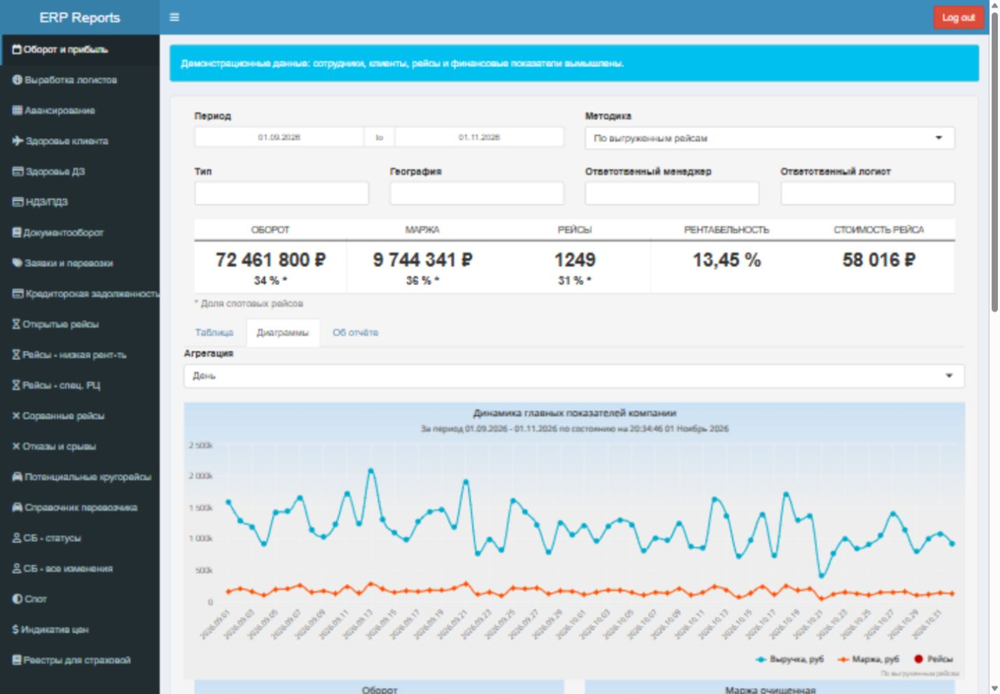
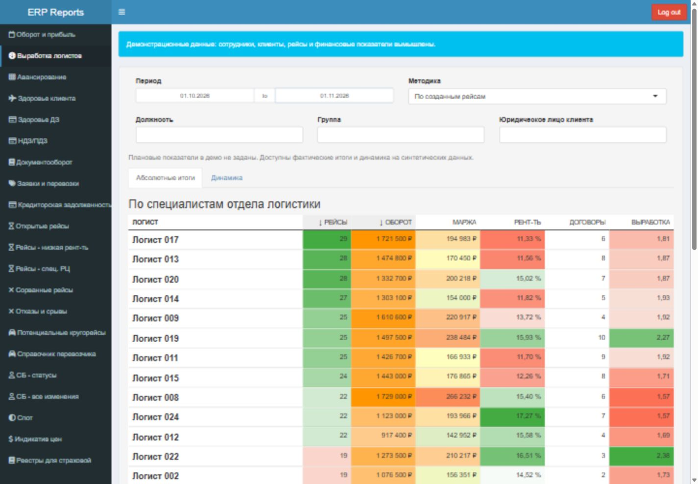
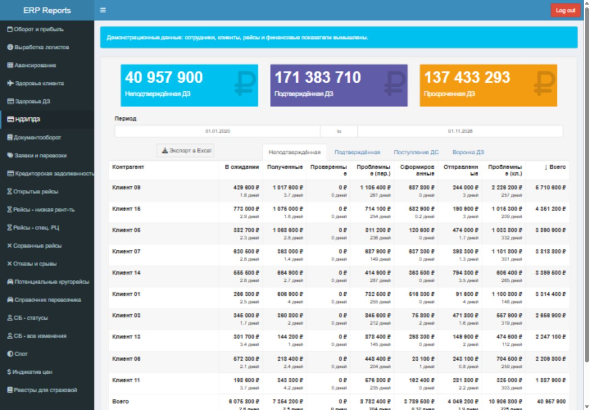
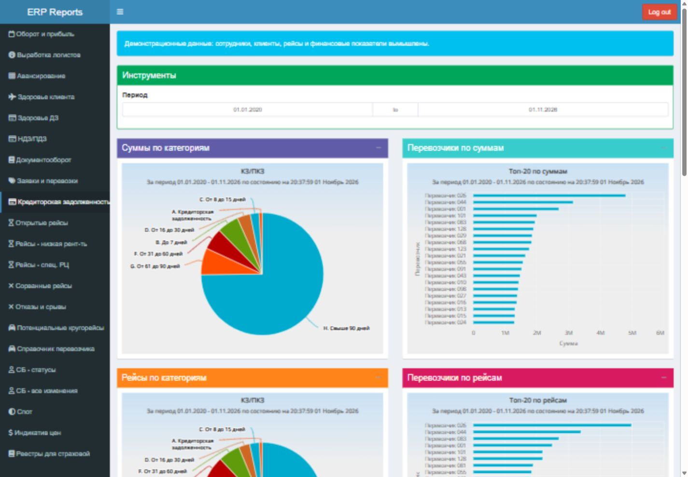
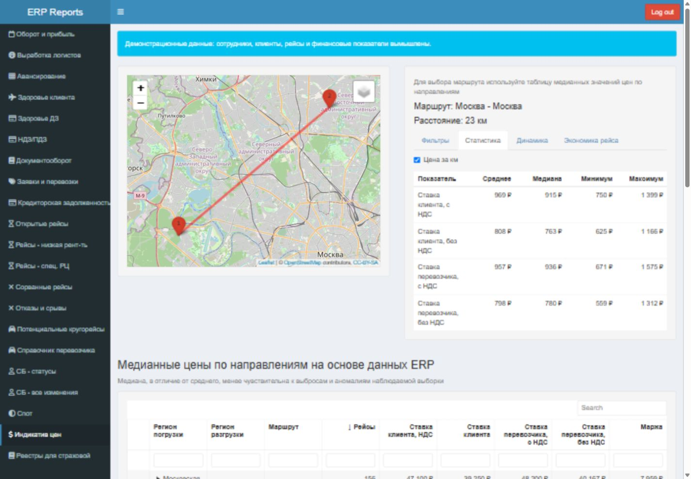
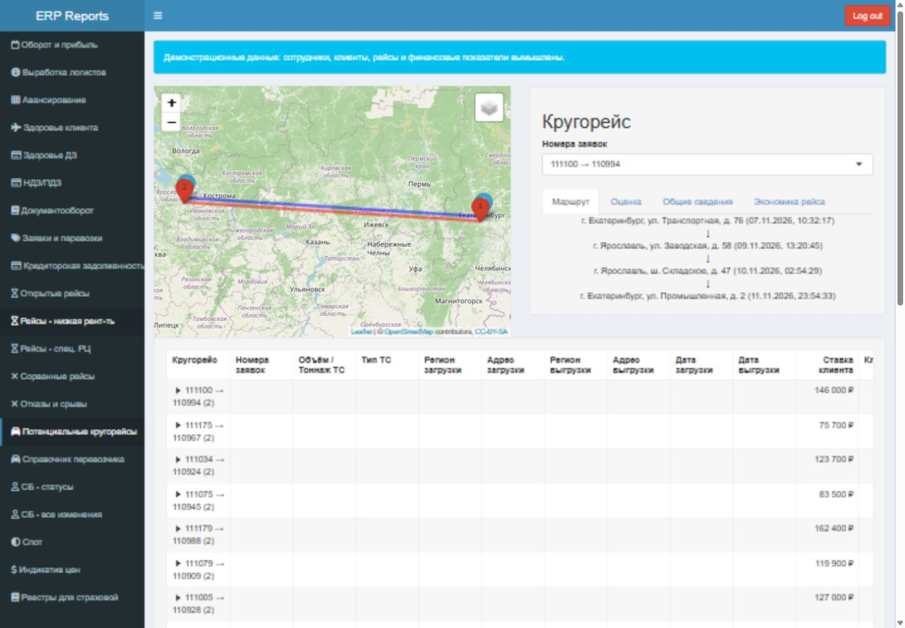
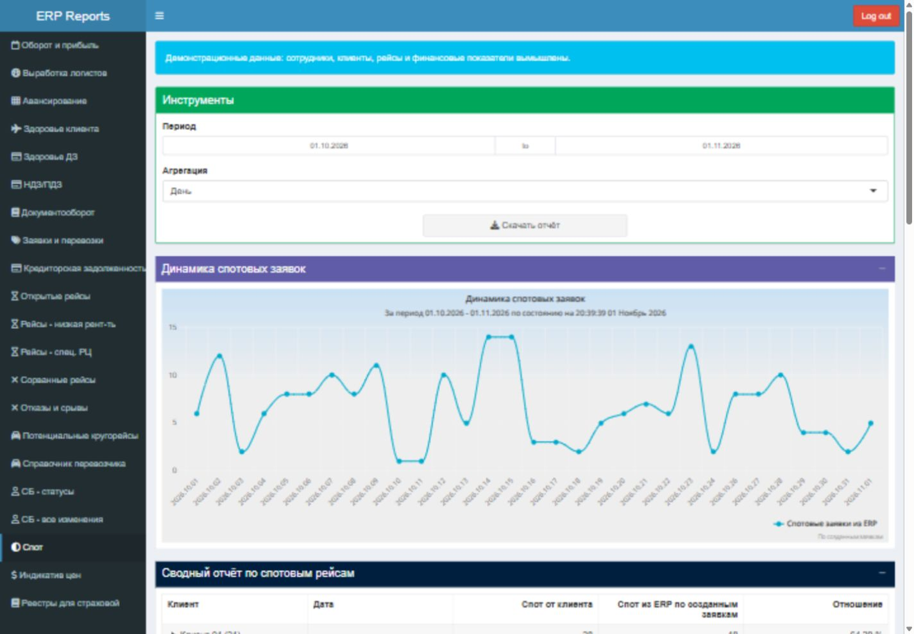
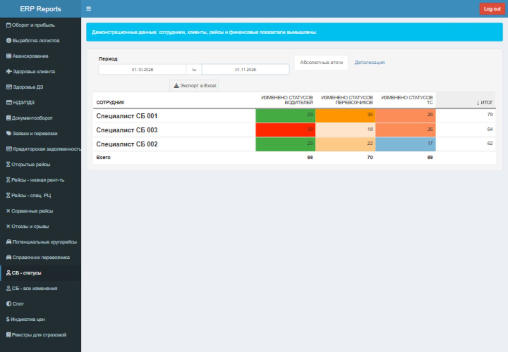

# ERP Reports — аналитика логистики на R/Shiny

BI-панель для FTL-экспедирования: оборот и маржа, KPI логистов, задолженность,
документооборот, ставки перевозчиков и поиск кругорейсов. Проект разрабатывался
в 2021–2023 годах и восстановлен в 2026 году как портфолио с локальным демо.

**Публичная версия работает на синтетических данных.** Справочники и операции
создаются генератором; реальные базы, фотографии, выгрузки, учётные данные и
история внутреннего репозитория в поставку не входят. Демо не подключается к
исходным сервисам компании.



## Возможности

В исходном приложении 32 определения вкладок. Демо-пользователь с ролью аналитика
видит 21 включённый пункт меню; часть сценариев требует пользовательского Excel.

| Отчёты | Задача |
|---|---|
| Оборот и прибыль | Оборот, очищенная от НДС маржа, рентабельность, динамика и сравнение клиентов |
| Выработка логистов | Рейсы, оборот, маржа и договоры по сотрудникам и группам с учётом рабочих дней |
| НДЗ/ПДЗ, здоровье ДЗ | Этапы подтверждения долга, просрочка, оборачиваемость и ожидание документов |
| Кредиторская задолженность | Обязательства перед перевозчиками по срокам оплаты |
| Документооборот | Проверка транспортных документов, счета и акты |
| Открытые и сорванные рейсы | Оперативная загрузка, отказы и срывы перевозок |
| Индикатив цен | Медианные ставки по направлениям, типам транспорта и целевой рентабельности |
| Потенциальные кругорейсы | Сопоставление встречных заявок и просмотр маршрута |
| Спот | Тендерные заявки и доля выигранных по площадкам |
| Служба безопасности | Статусы проверки и изменения справочников перевозчиков, водителей и транспорта |
| Реестры и выгрузки | Экспорт отфильтрованных данных в Excel |

Таблицы поддерживают фильтры, сортировку, группировку и раскрытие деталей.
Графики и карты связаны с выбранными периодами и срезами.

## Скриншоты

Изображения сняты с работающего локального демо на заново сгенерированных
данных. Числа иллюстрируют поведение отчётов и не описывают реальную компанию.

<details open>
<summary>Выработка логистов</summary>



</details>

<details>
<summary>Дебиторская и кредиторская задолженность</summary>




</details>

<details>
<summary>Индикатив цен и кругорейсы</summary>




</details>

<details>
<summary>Спот и служба безопасности</summary>




</details>

## Запуск

После запуска откройте `http://127.0.0.1:3838`, войдите как **`demo` / `demo`**.
Это демонстрационные учётные данные для локального использования.

### Windows: проверенный вариант

Проверенное окружение: R 4.0.4, PostgreSQL 16, отдельная библиотека R.
Установка на новой машине зависит от доступности архивного репозитория пакетов.

1. Установите R 4.0.4. По умолчанию сценарий ожидает его в
   `$env:LOCALAPPDATA\Programs\R\R-4.0.4`; иной путь задаётся параметром `-RHome`.
2. Установите пакеты из снимка Posit Package Manager:

   ```powershell
   $env:ERP_REPORTS_DEMO = 'true'
   $env:LANG = $env:LC_ALL = $env:LC_CTYPE = 'Russian_Russia.1251'
   & "$env:LOCALAPPDATA\Programs\R\R-4.0.4\bin\Rscript.exe" --vanilla demo/install_packages.R "$env:LOCALAPPDATA\R\erp-reports-lib"
   ```

3. Подготовьте PostgreSQL 16 и отдельную БД `erp_demo` на `127.0.0.1:5433`.
   Для уже запущенного локального кластера:

   ```powershell
   & "$env:LOCALAPPDATA\pgsql16\pgsql\bin\createdb.exe" -h 127.0.0.1 -p 5433 -U postgres erp_demo
   ```

   Создание БД выполняется один раз. `run_demo.ps1` не устанавливает PostgreSQL,
   не создаёт кластер и не создаёт саму БД. Для другого расположения бинарников
   передайте `-PgBin`; параметры подключения доступны в начале сценария.

4. Из корня проекта примените схему, создайте синтетические данные и запустите UI:

   ```powershell
   .\demo\run_demo.ps1 -Seed
   ```

   **`-Seed` пересоздаёт демо-схемы и данные. Используйте отдельную демо-БД.**
   Дальнейшие запуски: `.\demo\run_demo.ps1`.
   Для существующего портативного кластера в `$env:LOCALAPPDATA\pgsql16\data`
   можно добавить `-StartPg`. Если сервер уже работает, повторный запуск не нужен.

Сценарий задаёт совместимую локаль, библиотеку R и `ERP_REPORTS_DEMO=true`.
Приложение слушает только loopback. Данные привязаны к дате генерации;
после длительного перерыва их можно обновить повторным `-Seed`.

### Docker Compose: конфигурация подготовлена, сборка не подтверждена

```bash
docker compose -f demo/docker-compose.yml up --build
```

Compose описывает PostgreSQL, генерацию данных и приложение с портом
`127.0.0.1:3838`. Полная сборка на чистой машине не проверена; основной
подтверждённый способ запуска — Windows выше. Демо-контейнер не предназначен
для размещения в открытом интернете.

Генератор отказывается заполнять непустую БД. При повторном старте Compose
с сохранёнными данными сервис `seed` может остановиться; обновление контейнерного
демо и сохранение его данных пока требуют ручного управления.

## Устройство проекта

```text
global.R               зависимости, режим демо и общие настройки
ui.R, ui/*.R           меню, роли и определения отчётов
server.R               реактивные расчёты, визуализации и Excel
helpers.R              SQL и адаптер справочников
report_utils.R         безопасные расчёты отношений
production_calendar.R  рабочие дни и праздничные переносы
config.yml             имена переменных окружения, без секретных значений
demo/schema.sql        восстановленная схема PostgreSQL
demo/seed_demo.R        генератор синтетических данных
demo/elastic_stub.R     интерфейс справочников без Elasticsearch
demo/test_*             проверки отчётов и загрузчиков
docs/screenshots/      скриншоты синтетического демо
```

Стек: Shiny, shinydashboard/Plus, shinyauthr, reactable, highcharter, leaflet,
tidyverse, DBI/RPostgres, openxlsx/writexl, osrm/sf.

В демо четыре логических подключения направлены в одну PostgreSQL-базу:
27 доменных таблиц и 7 таблиц справочников `search_index`. Генератор создаёт
около 11 тысяч заявок за полтора года, связанные перевозки, счета, документы,
историю статусов JSONB и тендеры. Случайный seed фиксирован, даты — относительные.

Аналитика использует CTE, оконные функции, `DISTINCT ON`, агрегаты с `FILTER`
и разбор JSONB; дальнейшие расчёты и представление выполняются в R.
Публичная версия сохраняет структуру исходного приложения: сервер и слой данных
остаются крупными файлами, это не переработка на новый стек.

## Проверки

```powershell
.\demo\test_reports.ps1
.\demo\test_reports.ps1 -WithDatabase
```

Первый сценарий проверяет календарь, KPI, отношения, месячные корзины ДЗ,
жизненный цикл синтетики, выбор кругорейса, форматирование таблиц, изоляцию
демо-конфигурации, авторизацию и реестры без исходных Excel-шаблонов.
Второй дополнительно вызывает 70 загрузчиков в режиме read-only, только для
локальной `erp_demo:5433`. PostgreSQL должен быть запущен и наполнен.

Проверки пройдены 1 ноября 2026 года: 9 регрессионных сценариев и 70/70
загрузчиков. В браузере проверены 18 разделов исходного демо; после очистки
справочников повторно просмотрены основные отчёты и скачан демо-реестр страхования.
Это не полное покрытие всех ролей и бизнес-методик. Проверки публичной поставки
и её состав описаны в [docs/PUBLICATION.md](docs/PUBLICATION.md).

## Границы демо

- Календарь: 01.11.2021–31.12.2027, федеральная пятидневка с переносами.
  Сокращённый день считается рабочим; региональные праздники и сменные графики
  не моделируются. Для новых лет нужны утверждённые переносы.
- KPI показывает фактические значения: исторические Excel-планы не поставляются.
- «Здоровье клиента» требует пользовательского Excel с издержками; этот сценарий
  не проверялся. Демо-реестры не являются юридически действующими документами.
- Маршруты используют публичный OSRM; при недоступности рисуется прямая линия.
  Такая линия не является рассчитанным дорожным маршрутом. Подложки карт также
  требуют доступа к внешнему сервису.
- Автоматические рассылки, внутренний деплой и интеграции с реальной ERP
  не входят в публичную поставку. Production-режим не является поддерживаемым
  сценарием этой демонстрационной версии.

## Подготовка публичной копии

Публичная поставка собирается по явному списку файлов, без `.git`, исходных
Excel, фотографий, локальных конфигураций и журналов. Порядок сборки и проверки:
[docs/PUBLICATION.md](docs/PUBLICATION.md).

Если вы работаете в исходной рабочей копии со старой историей, публикуйте
**подготовленный экспорт**, а не её текущую ветку: удаление секретов из
последней версии файлов не очищает предыдущие коммиты.
